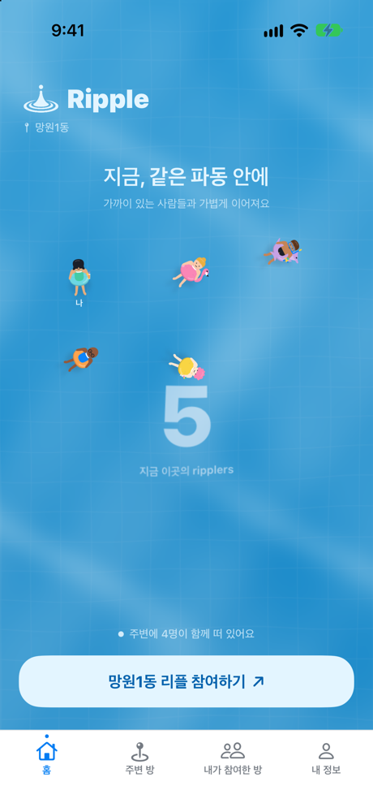
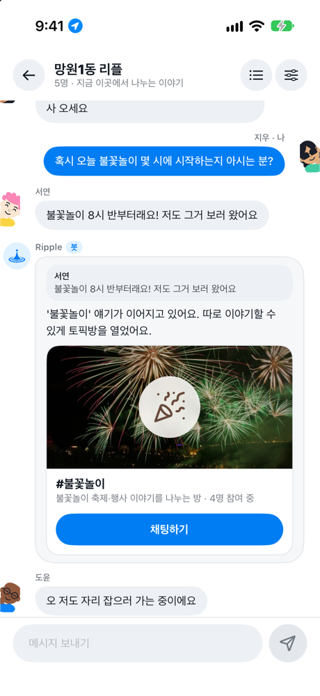
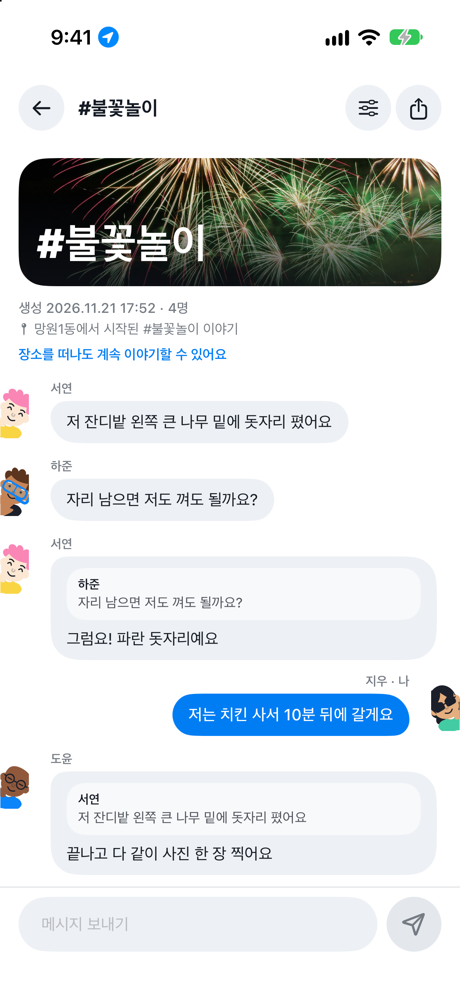

# Ripple

**지금, 같은 파동 안에.** 가까이 있는 사람들과 가볍게 이어지는 iOS 앱이에요.

반경 안에 있는 사람들이 같은 동네 채팅방(리플)에 모여요. 대화하다 같은 주제가 이어지면 AI 봇이 그 주제만 이야기하는 토픽방을 열어 줘요. 토픽방은 장소를 떠나도 계속 이어져요.

SM@THON 해커톤 출품작이에요.

<table>
  <tr>
    <td align="center"></td>
    <td align="center"></td>
    <td align="center"></td>
  </tr>
  <tr>
    <td align="center"><b>홈</b><br>지금 근처에 있는 사람들이<br>캐릭터로 떠 있어요</td>
    <td align="center"><b>동네방</b><br>같은 주제가 이어지면<br>봇이 토픽방을 열어요</td>
    <td align="center"><b>토픽방</b><br>관심 있는 사람끼리<br>따로 이어서 이야기해요</td>
  </tr>
</table>

## 이렇게 동작해요

1. **근처 사람 찾기**: 앱을 켜면 위치를 2초마다 서버에 보내요. 반경 안에 있는 사람들이 홈 수영장에 캐릭터로 나타나요. 정확한 위치는 다른 사람에게 보이지 않아요.
2. **동네방(리플)**: '참여하기'를 누르면 근처 사람들이 이미 들어가 있는 방으로 들어가요. 범위를 벗어나면 방에서 자동으로 빠지고, 다시 다가오면 같은 방으로 돌아와 이전 대화를 이어 가요.
3. **토픽방**: AI가 메시지마다 주제를 뽑아요. 한 사람이 꺼낸 주제에 다른 사람이 같은 주제로 반응하면 토픽이 확정되고, 두 사람은 자동으로 참여해요. 나머지 사람은 카드의 '참여하기'로 골라서 들어가요.
4. **알림**: 그 채팅방 화면을 보고 있지 않으면 새 메시지를 바로 알려 줘요. 토픽마다 알림을 끌 수 있어요.

## 구조

```
server/   FastAPI · SQLAlchemy(SQLite/Postgres) · Redis · APNs · Claude API(토픽 분류)
ios/      SwiftUI (iOS 17+) · XcodeGen · Metal 셰이더(수영장 물결)
docs/     README 캡처
```

| 부분 | 핵심 파일 |
| --- | --- |
| 방 배정·범위 이탈·재입장 | `server/app/routers/geo.py` |
| 토픽 분류·확정 | `server/app/services/topics.py`, `categories.py` |
| 실시간 채팅 | `server/app/routers/ws.py` (방·토픽마다 Redis Pub/Sub 채널) |
| 앱푸시 판단·전송 | `server/app/services/notify.py`, `apns.py` |
| 위치·소켓·푸시 (iOS) | `ios/Ripple/Core/Services.swift`, `PushService.swift`, `App/RippleApp.swift` |
| 화면·디자인 (iOS) | `ios/Ripple/Features/`, `ios/Ripple/DesignSystem/` |

## 실행하기

### 서버

```bash
cd server
python3 -m venv .venv && source .venv/bin/activate
pip install -r requirements-dev.txt
cp .env.example .env    # JWT_SECRET, PHONE_HMAC_SECRET 채우기, 로컬은 REDIS_URL=fake:// 로도 돼요
uvicorn app.main:app --host 0.0.0.0 --port 8000 --reload
```

- API 문서: http://localhost:8000/docs
- 테스트: `pytest -q` (문자는 항상 콘솔로만 출력, 실제 발송 안 함)
- `SMS_PROVIDER=console`이면 인증번호가 서버 로그에 찍혀요
- Docker: `docker compose up --build` (Postgres + Redis + Worker)

### iOS

준비물: Xcode, [XcodeGen](https://github.com/yonaskolb/XcodeGen)(`brew install xcodegen`), Metal 툴체인(`xcodebuild -downloadComponent MetalToolchain`)

```bash
cd ios/Config
for f in *.xcconfig.example; do cp "$f" "${f%.example}"; done   # 키·서버 주소는 여기에 (git에 안 올라감)
cd .. && xcodegen generate && open Ripple.xcodeproj
```

- `Shared.xcconfig`에 카카오 네이티브 앱 키, `Debug.xcconfig`에 서버 주소를 넣어요 (시뮬레이터는 `localhost`).
- 팀·번들 ID는 `project.yml`에서 바꾸고 `xcodegen generate`를 다시 실행해요.
- Debug 빌드에는 **개발 로그인**이 있어 카카오·애플 설정 없이 바로 써 볼 수 있어요. 서버 `.env`에 `ALLOW_DEV_LOGIN=true`가 필요해요 (`ENV=prod`면 항상 꺼짐).
- 위치는 시뮬레이터 메뉴 Features > Location > Custom Location으로 정해요.

### 외부 키 (모두 `server/.env` 또는 `ios/Config/*.xcconfig`)

| 항목 | 용도 | 없으면 |
| --- | --- | --- |
| 카카오 네이티브 앱 키 · 앱 ID | 카카오 로그인 | 개발 로그인·애플 로그인만 |
| 카카오 REST 키 | 동네·건물 이름 | "이 근처"로 표시 |
| Apple 키(.p8) | 애플 로그인 탈퇴 처리 | 로그인은 됨 |
| APNs 키(.p8) | 앱푸시 | 알림 안 보내고 로그만 |
| `ANTHROPIC_API_KEY` | AI 토픽 분류 (`TOPIC_CLASSIFIER=claude`) | 규칙 분류(`app/topics_seed.json`) |
| 센드온 | 휴대폰 인증 문자 | `SMS_PROVIDER=console` |

## API 요약

| 메서드 | 경로 | 설명 |
| --- | --- | --- |
| POST | `/auth/kakao`, `/auth/apple`, `/auth/dev` | 로그인 |
| POST | `/auth/phone/request`, `/auth/phone/verify` | 휴대폰 인증 |
| GET · PATCH · DELETE | `/me` | 내 정보, 닉네임·캐릭터, 탈퇴 |
| POST | `/presence` | 위치 보고. 범위를 벗어나 빠진 방·다시 들어간 방을 응답 |
| GET | `/nearby` | 근처 인원·캐릭터·지금 위치 이름 |
| POST | `/rooms/join` | 근처 사람이 있는 방으로 배정, 없으면 새로 |
| GET | `/rooms/{id}/messages`, `/rooms/{id}/topics` | 동네방 대화·토픽 |
| GET · PATCH | `/topics/{id}` | 토픽 정보, 알림 끄기 |
| POST | `/topics/{id}/join`, `/topics/{id}/leave` | 토픽 참여·나가기 |
| GET | `/me/chats` | 지금 동네방과 참여한 토픽 (7일) |
| POST · DELETE | `/push/devices` | 푸시 기기 등록·해제 |
| WS | `/ws/rooms/{id}`, `/ws/topics/{id}` | 실시간 채팅 (답장 `reply_to` 지원) |

## 이미지 출처

토픽 카테고리 사진은 Openverse의 CC0 사진이에요. 출처는 [`server/tools/topic-images/photos/CREDITS.md`](server/tools/topic-images/photos/CREDITS.md)에 있어요.
